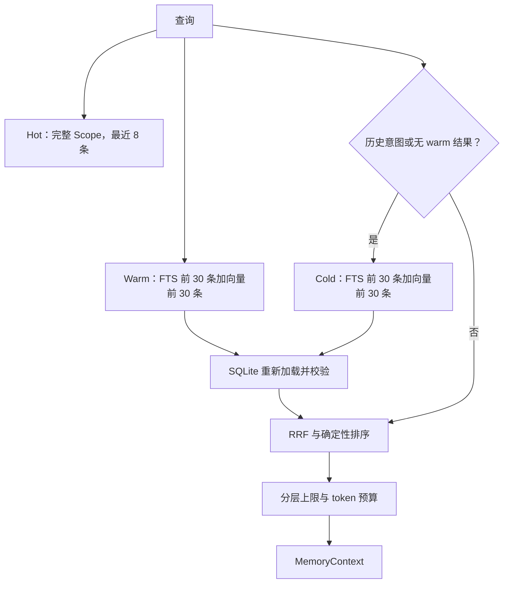

# 三层混合检索

`MemoryRetriever` 将确定性的 hot 上下文与 FTS5、Qdrant 候选检索结合。SQLite 是唯一事实源：Qdrant 点必须先根据 UUID 从 `memory_records` 重新加载并校验，之后才能注入上下文。

## Scope 与生命周期规则

- Hot 记录为 `active/hot`，必须匹配 owner、channel 和 conversation。
- 已确认的 warm 事实跨会话匹配 owner 和 channel。Warm 候选和活跃摘要必须匹配完整 scope。
- Cold 记录只能为 `archived/cold`；它们匹配 owner 和 channel，仅作为历史证据，不能覆盖已确认事实。
- 向量候选还必须满足 `embedding_status=ready`。向量等待期间，FTS 候选仍可被检索，因为 SQLite 仍然可用。
- SQLite 重新加载时，来自错误 Qdrant 集合、层级不匹配、状态过期或 scope 不属于当前请求的记录都会被丢弃。

## 排序与上下文

Warm 和 cold 排名使用 `k=60` 的倒数排名融合。顺序是确定性的：已确认事实、完整 scope、融合分数、置信度、最后是新近度。默认上限为 8 条 hot 消息、6 条已确认事实、4 条其他 warm 记录和 5 条 cold 证据记录。候选记忆渲染到独立上下文段。只有查询要求来源/依据/历史，或检索到历史冲突时，引用才包含时间、类型和简短内容摘要。
